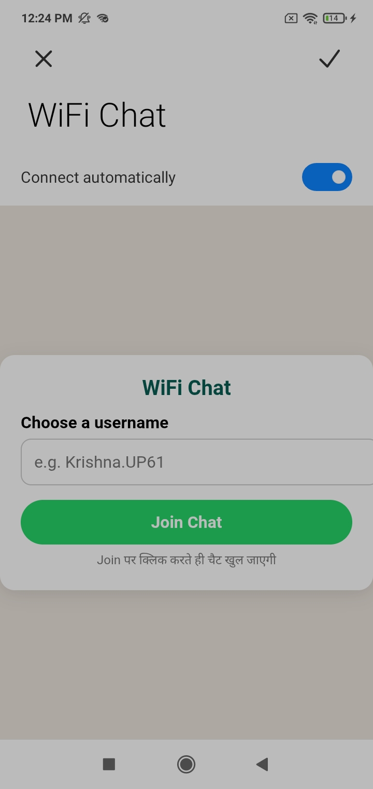
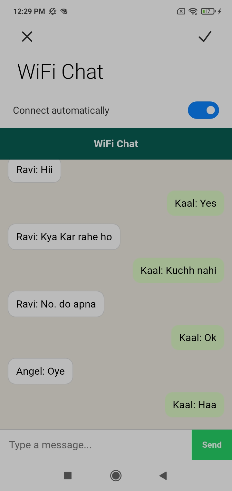

<div align="center">


# ⚡ ESP32 WiFi Chat

### 🚀 Turn Your ESP32 Into a Wireless Chat Server

**A lightweight, real-time, multi-user chat platform powered by ESP32 — no internet, no router, and no external server required!**

<p>
  
  
  
  
</p>

<p>
  <b>Created with ❤️ by Krishna Rajput UP61</b>
</p>

[🌐 Live Flash Tool](https://esp32king.pages.dev) •
[📥 Download Firmware](https://github.com/esp32king2/Esp32-WiFi-Chat) •
[▶️ Watch Demo](https://www.youtube.com/shorts/AOwGbn9QvEQ?feature=share)

</div>

---

## 🌌 About The Project

**ESP32 WiFi Chat** is an ESP32-based wireless messaging system that allows multiple users to communicate through a locally hosted WiFi network.


## ✨ Features

| Feature | Description |
|---|---|
| 📡 WiFi Hotspot | ESP32 creates its own wireless network |
| 💬 Real-Time Chat | Communicate with connected users |
| 👥 Multi-User Support | Multiple users can join the chat |
| 👤 Username Selection | Choose your own display name |
| 🚫 Duplicate Protection | Duplicate usernames are not allowed |
| 🌐 Captive Portal | Access the chat through a browser |
| 📱 Mobile Friendly | Designed for smartphone access |
| ⚡ Fast Messaging | Lightweight local communication |
| 🔌 Offline Operation | No internet required |
| 💻 Cross-Device Access | Connect using supported WiFi devices |

---

## 📸 Screenshots

<div align="center">

### 💬 Fast Chat Interface



### 👤 Username Selection



</div>

---

## ⚙️ How It Works

```text
       📱 Smartphone
             |
       📡 Connect to WiFi
             |
             ▼
       ⚡ ESP32 Hotspot
             |
       🌐 Captive Portal
             |
             ▼
       💬 Chat Interface
             |
       👥 Multiple Users
             |
             ▼
       ⚡ Wireless Messaging
```

### Connection Process

1. ESP32 creates a WiFi access point.
2. Users connect to the ESP32 network.
3. Captive Portal opens the chat interface.
4. Users select unique usernames.
5. Start sending and receiving messages.

**Direct Access:** `http://192.168.4.1`

---

# 🔥 Installation & Flashing Guide

You can flash the firmware using an Android ESP32 Loader application or a compatible browser-based ESP32 flash tool.

## 🛠️ Requirements

- ESP32 Development Board
- Android Smartphone / PC
- USB Data Cable
- ESP32 Flashing Tool
- Firmware BIN Files

## 🚀 Method 1 — Complete Firmware Flash

### Step 1: Open Flashing Tool

Open the ESP32 flashing tool:

👉 **[OPEN ESP32 FLASH TOOL](https://esp32king.pages.dev)**

Connect your ESP32 using a USB cable and select the correct serial port.

### Step 2: Download Firmware Files

Download the following three firmware files:

| Firmware File | Flash Address |
|---|---|
| `bootloader.bin` | `0x1000` |
| `partitions.bin` | `0x8000` |
| `Esp32-WiFi-Chat-On-Captive-Portal.bin` | `0x10000` |

**Direct Downloads:**

- [⬇️ bootloader.bin](https://github.com/esp32king2/Esp32-WiFi-Chat/raw/refs/heads/main/bootloader.bin)
- [⬇️ partitions.bin](https://github.com/esp32king2/Esp32-WiFi-Chat/raw/refs/heads/main/partitions.bin)
- [⬇️ ESP32 WiFi Chat Firmware](https://github.com/esp32king2/Esp32-WiFi-Chat/raw/refs/heads/main/Esp32-WiFi-Chat-On-Captive-Portal.bin)

### Step 3: Configure Flash Addresses

Add the downloaded files to the flashing tool using these exact addresses:

```text
bootloader.bin
Address: 0x1000

partitions.bin
Address: 0x8000

Esp32-WiFi-Chat-On-Captive-Portal.bin
Address: 0x10000
```

### Step 4: Flash Firmware

1. Verify all three file addresses.
2. Select the correct ESP32 board/port.
3. Start the flashing process.
4. Wait until flashing completes.
5. Restart your ESP32.

<details>
<summary><b>⚡ Method 2 — Flash Only The Main Sketch</b></summary>

If your ESP32 already has the correct bootloader and partition table, you can flash only the main application firmware.

Download:

[ESP32-WiFi-Chat-On-Captive-Portal.bin](https://github.com/esp32king2/Esp32-WiFi-Chat/raw/refs/heads/main/Esp32-WiFi-Chat-On-Captive-Portal.bin)

Flash Address:

```text
0x10000
```

**Important:** This method is suitable only when the existing bootloader and partition configuration are compatible with this firmware.

</details>

---

## 📲 How To Connect & Start Chatting

1. Power ON your ESP32.
2. Search for its WiFi hotspot from your smartphone.
3. Connect to the ESP32 WiFi network.
4. Open the Captive Portal if it appears automatically.
5. If it doesn't open, visit:

```text
http://192.168.4.1
```

6. Choose your username.
7. Join the chat room.
8. Start chatting with other connected users!

---

## 🧰 Troubleshooting

<details>
<summary>❓ Captive Portal Not Opening?</summary>

Manually open:

`http://192.168.4.1`

Make sure your device is connected to the ESP32 WiFi network.

</details>

<details>
<summary>❓ ESP32 WiFi Network Not Showing?</summary>

- Restart the ESP32.
- Check the USB power supply.
- Verify that firmware flashing completed successfully.
- Check board compatibility.

</details>

<details>
<summary>❓ Flashing Failed?</summary>

- Verify the correct COM/serial port.
- Check the USB data cable.
- Verify all firmware addresses.
- Try entering ESP32 download mode.
- Make sure the firmware matches your ESP32 board.

</details>

<details>
<summary>❓ Username Already Exists?</summary>

Choose another unique username. Duplicate usernames are not allowed.

</details>

---

## 📺 Video Demonstration

<div align="center">

<a href="https://www.youtube.com/shorts/AOwGbn9QvEQ?feature=share">

</a>

### ▶️ Watch ESP8266 Version Demo

[**WATCH ON YOUTUBE**](https://www.youtube.com/shorts/AOwGbn9QvEQ?feature=share)

</div>

---

## 🔧 ESP8266 Support

Want to use this project with ESP8266?

ESP8266 support requires a compatible firmware build and suitable hardware configuration.

Check the video demonstration above for the ESP8266 version.

---

## ⚠️ Important Notes

- This project is designed for local WiFi communication.
- Internet access is not required for local chatting.
- Actual simultaneous user capacity depends on ESP32 hardware, available memory, and firmware implementation.
- Keep your ESP32 powered while using the chat.
- Firmware compatibility depends on the exact ESP32 board and flash configuration.

---

## 🤝 Credits & Contribution

**Original Project Creator: Krishna Rajput UP61**

If you use, modify, or redistribute this project:

- Give proper credit to the original creator.
- Keep attribution intact.
- Share improvements with the community.
- Respect the original project license, if specified.

Contributions, suggestions, and improvements are welcome!

---

## ⭐ Support The Project

If you like this project:

- ⭐ Star this repository.
- 🍴 Fork the project.
- 📢 Share it with ESP32 developers.
- 💬 Report bugs and suggest improvements.
- ❤️ Give proper credits when using this project.

---

<div align="center">

# ⚡ BUILT FOR MAKERS. POWERED BY ESP32.

**Created By Krishna Rajput UP61**

*Connecting people, one ESP32 at a time.*


**© 2026 GodxShadow - Krishna Rajput UP61. All Rights Reserved.**

</div>
